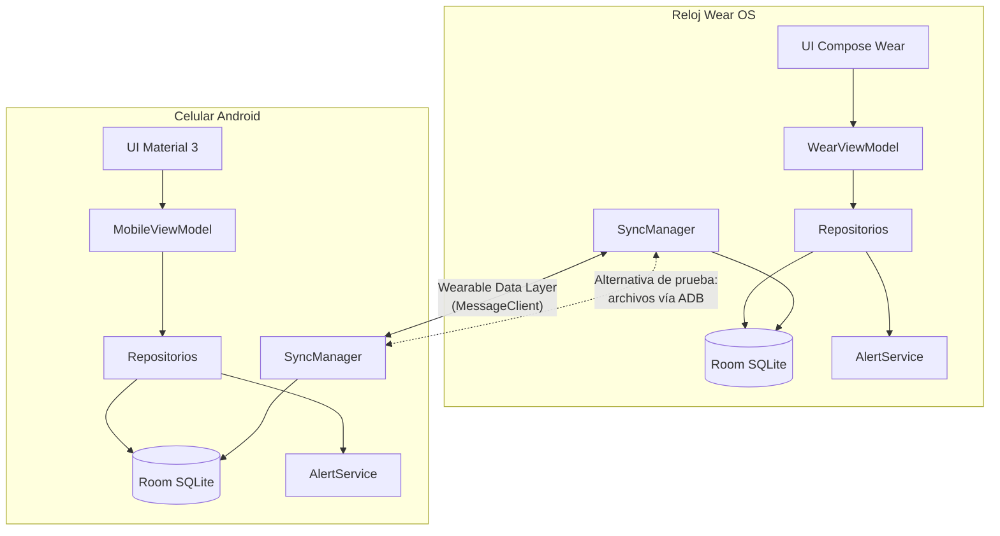

# 2. Arquitectura

## 2.1 Módulos

```
┌─────────────────────────────┐        ┌─────────────────────────────┐
│  :wear  (app reloj)         │        │  :mobile  (app celular)     │
│  Compose for Wear OS        │        │  Compose + Material 3       │
│  WearViewModel, pantallas   │        │  MobileViewModel, pantallas │
└──────────────┬──────────────┘        └──────────────┬──────────────┘
               │ depende de                           │ depende de
               └──────────────┬───────────────────────┘
                              ▼
        ┌─────────────────────────────────────────────────┐
        │  :core:data  (Android library)                  │
        │  ├─ local/        Room: entidades, DAOs, BD     │  Almacenamiento local
        │  ├─ repository/   Expense/Budget/Category Repo  │  Reglas de crear/editar/borrar
        │  ├─ alerts/       AlertService, Notifier, Haptics│ Notificaciones
        │  ├─ sync/         SyncManager, ListenerService, │  Comunicación entre dispositivos
        │  │                RoomSyncStore, AdbSyncReceiver│
        │  ├─ demo/         DemoDataSeeder                │  Datos de prueba
        │  └─ MicroBudgetGraph (inyección manual)         │
        └──────────────────────┬──────────────────────────┘
                               ▼
        ┌─────────────────────────────────────────────────┐
        │  :core:domain  (Kotlin puro, sin Android)       │
        │  ├─ model/    Expense, Budget, Category         │
        │  ├─ money/    Money, AmountValidator, teclado   │
        │  ├─ budget/   PeriodCalculator, BudgetCalculator│  Gestión de presupuestos
        │  │            AlertEngine, AffordabilityChecker │
        │  ├─ stats/    StatsCalculator, ExpenseFilter    │  Historial y estadísticas
        │  └─ sync/     DTOs, ConflictResolver,           │  Protocolo de sincronización
        │               SyncProtocol (PUSH/ACK)           │
        └─────────────────────────────────────────────────┘
```

Regla: las APIs de Android solo existen en `:core:data`, `:wear` y `:mobile`. La lógica de negocio (`:core:domain`) se prueba en la PC con JUnit, sin emulador. No hay APIs de Apple.



## 2.2 Flujo de registro de un gasto

1. UI → `ExpenseRepository.add()` valida importe (`AmountValidator`) y categoría.
2. Se guarda en Room con `updatedAt = ahora` y `syncStatus = PENDING`.
3. `AlertService.evaluateAndNotify()` recalcula el resumen desde la tabla y aplica `AlertEngine`.
4. `SyncManager.requestSync()` intenta enviar el cambio al otro dispositivo.
5. La UI observa `Flow`s de Room, así que totales, historial y gráficas se actualizan solos.

## 2.3 Sincronización

**Transporte principal**: Wearable Data Layer `MessageClient` (rutas `/microbudget/sync/push` y `/microbudget/sync/ack`). Requiere que ambas apps tengan el mismo `applicationId` (`com.microbudget`) y la misma firma (en debug, la llave de depuración de la PC). Un `WearableListenerService` recibe mensajes aunque la app esté cerrada y, gracias a la *capability* `microbudget_sync`, intenta sincronizar cuando el otro dispositivo vuelve a estar conectado.

**Transporte alternativo de prueba**: si los emuladores no están emparejados (lo más común en Windows sin cuenta de Google en el emulador), `tools/simular-sync.ps1` intercambia los mismos paquetes como archivos JSON por ADB. El `AdbSyncReceiver` está protegido con el permiso `DUMP`, que solo tiene el shell de ADB.

### Protocolo PUSH/ACK

```
Reloj (A)                                   Celular (B)
buildPush(): cambios PENDING  ── PUSH ──▶   handlePush(): fusiona cada registro (LWW)
                                            los que acepta quedan SYNCED en B
handleAck(): fusiona y marca   ◀── ACK ──   responde con su versión ganadora de cada id
SYNCED lo que B confirmó tener idéntico
```

- Un registro solo pasa a **SYNCED** cuando el otro dispositivo demuestra tener **la misma versión** (`id` + `updatedAt` + contenido).
- Sin conexión → los cambios siguen **PENDING** y se reenvían en el siguiente intento (al abrir la app, tras cada cambio, al reconectar o con «Sincronizar ahora»).
- Los borrados viajan como **lápidas** (`deleted = true`) para que la eliminación llegue al otro dispositivo.
- Los paquetes grandes se dividen en bloques de 150 gastos (límite de tamaño de MessageClient).

### Resolución de conflictos (mismo gasto editado en ambos dispositivos)

Estrategia **Last-Writer-Wins** (`ConflictResolver`):

1. Si no existe localmente → se acepta el remoto.
2. Si son idénticos → solo se marca como sincronizado.
3. Gana el `updatedAt` más reciente (la última edición, venga de donde venga).
4. Empate exacto de `updatedAt`: gana el **borrado**; si ninguno es borrado, desempate determinista por contenido para que ambos dispositivos elijan el mismo ganador.

`updatedAt` siempre crece (`max(ahora, anterior + 1)`) aunque el reloj del sistema retroceda. Limitación documentada: depende de que la hora de ambos dispositivos sea razonablemente correcta (en emuladores se toma de la PC).

## 2.4 Notificaciones y vibración

- Canal `budget_alerts` de importancia alta. En Android 13+ se pide `POST_NOTIFICATIONS` al primer arranque.
- Las notificaciones son `setLocalOnly(true)`: cada dispositivo muestra las suyas y el celular no las reenvía al reloj (evita duplicados).
- Si no hay permiso, la alerta se muestra **dentro de la app** (tarjeta en el reloj, banner en el celular).
- Vibración con `VibratorManager`. El emulador no vibra físicamente: por eso siempre hay confirmación visual animada.

## 2.5 Tecnologías y versiones

| Componente | Versión |
|---|---|
| Android Studio | Ladybug 2024.2 (Windows) |
| Gradle / AGP | 8.11.1 / 8.7.3 |
| Kotlin / KSP | 2.0.21 / 2.0.21-1.0.28 |
| Compose BOM | 2024.12.01 |
| Wear Compose | 1.4.0 |
| Room | 2.6.1 |
| play-services-wearable | 18.2.0 |
| Java (incluido en Android Studio) | JBR 21 (compila a JVM 17) |
| SDK | compileSdk 35; reloj minSdk 30 / target 34; celular minSdk 26 / target 35 |
