# 3. Diseño de pantallas

Todas las capturas son **reales**, tomadas de los emuladores en Windows (`Wear OS Large Round API 34` y `Medium Phone API 35`).

## 3.1 Principios de diseño

| | Reloj | Celular |
|---|---|---|
| Objetivo | Registrar en segundos y consultar de un vistazo | Gestionar y analizar |
| Navegación | Lista vertical + deslizar a la derecha para volver (gesto Wear OS) | Barra inferior: Inicio · Historial · Gráficas · Ajustes |
| Entrada | Teclado numérico grande, categorías con emoji, sin formularios | Formulario completo con fecha, hora y descripción |
| Indicador de presupuesto | Anillo en el borde de la pantalla | Tarjeta con barra de progreso |
| Pantallas | 9 (ver mapa) | 6 |

**Paleta**: morado `#8B5CF6` (principal), fondo `#0E0A1A`, superficies `#1E1832`, texto blanco y gris `#B9B4C9`, verde `#22C55E` (disponible), naranja `#F59E0B` (≥ 80 %), rojo `#EF4444` (excedido). El color nunca es la única señal: siempre va acompañado de texto ("Disponible", "Excedido", "%").

## 3.2 Reloj (Wear OS)

### Mapa de navegación

```
                    ┌──────────────┐
                    │   Inicio     │──► Historial ──► Detalle (eliminar)
                    │ anillo + $   │──► Presupuesto ──► Teclado (monto / límite)
                    └──────┬───────┘──► Ajustes y sync
             Nuevo gasto   │    ¿Me alcanza?
                    ▼                  ▼
   Teclado ──► Categoría ──► Confirmar ──► ¡Guardado! (+ alerta) ──► Inicio
                    ▲                  │
                    └── «Registrar este gasto» ◄── Resultado ¿Me alcanza?
```

### Registro de un gasto (5 pasos del enunciado)

| 1. Inicio | 2. Cantidad | 3. Categoría | 4. Confirmar | 5. Confirmación |
|:-:|:-:|:-:|:-:|:-:|
| 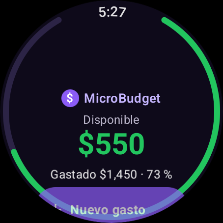 | 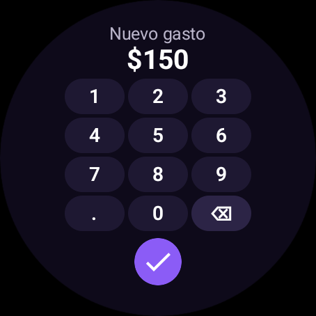 | 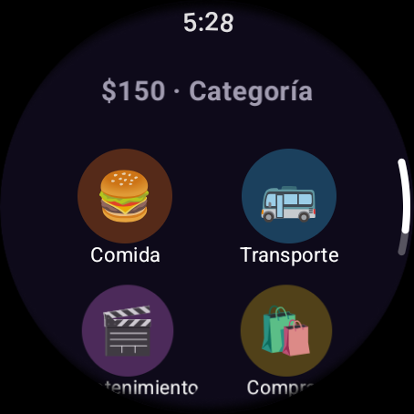 | 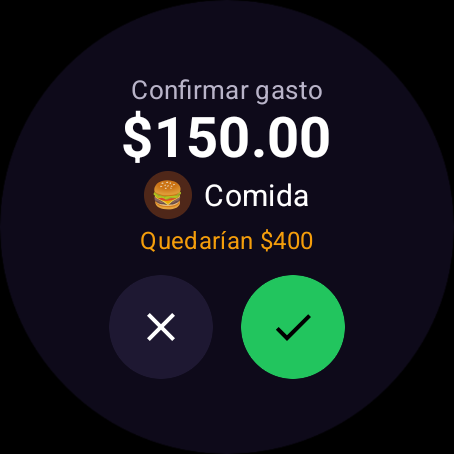 | 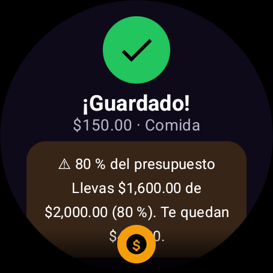 |
| Disponible, gastado, %, anillo y botón grande | Teclas proporcionales al diámetro; bloquea 3er decimal | 2 por fila, un toque avanza | Muestra cuánto quedaría | Animación + vibración; aquí además la alerta del 80 % |

### Otras pantallas

| Alerta 100 % | Excedido | ¿Me alcanza? | Historial | Presupuesto |
|:-:|:-:|:-:|:-:|:-:|
| 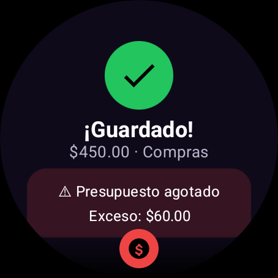 | 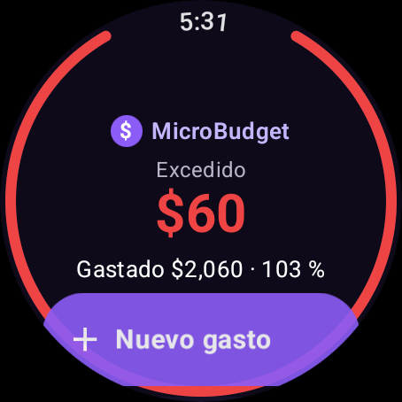 | 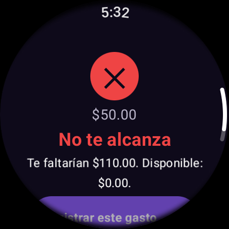 | 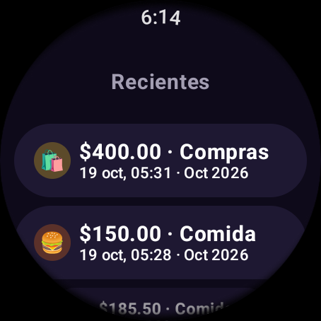 | 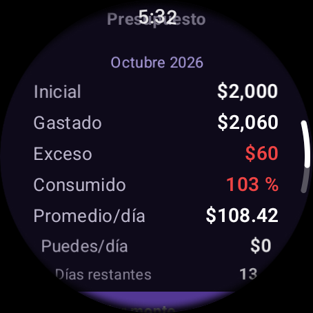 |

- **Historial**: máximo 10 movimientos; cantidad · categoría, fecha/hora · periodo. `⟳` = pendiente de sincronizar.
- **Presupuesto**: inicial, gastado, disponible/exceso, %, promedio diario, cuánto se puede gastar por día, días restantes; cambiar monto, periodo (semanal/mensual) y alertas.
- **Ajustes y sync**: estado de conexión, pendientes, última sincronización, «Sincronizar ahora», datos demo, probar notificación, rearmar alertas, borrar datos.

## 3.3 Celular

| Inicio | Inicio (gráfica) | Historial con filtros | Gráficas |
|:-:|:-:|:-:|:-:|
| 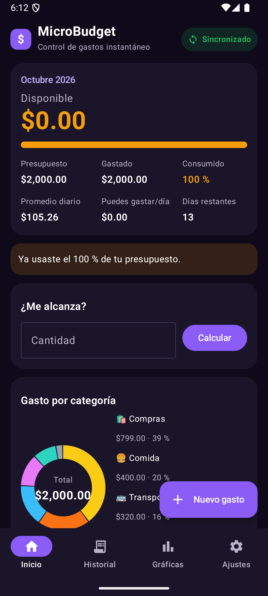 | 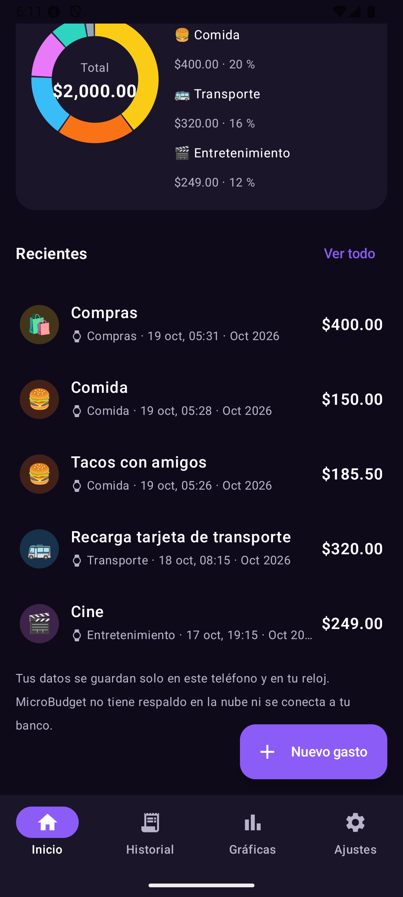 | 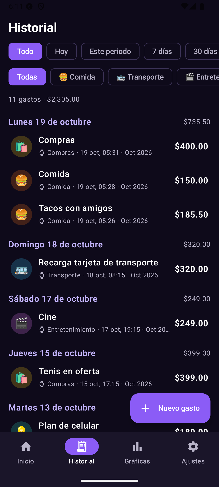 | 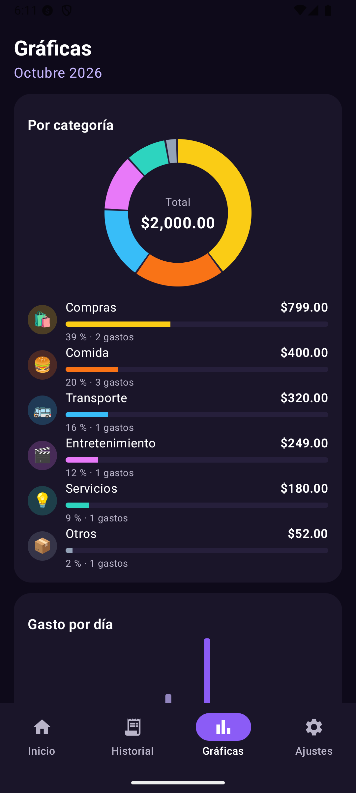 |

| Formulario (validación) | Ajustes | Sincronización | Alerta recibida tras sincronizar |
|:-:|:-:|:-:|:-:|
| 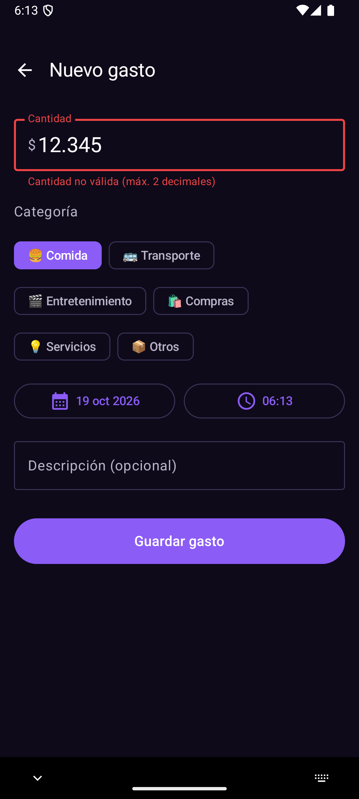 | 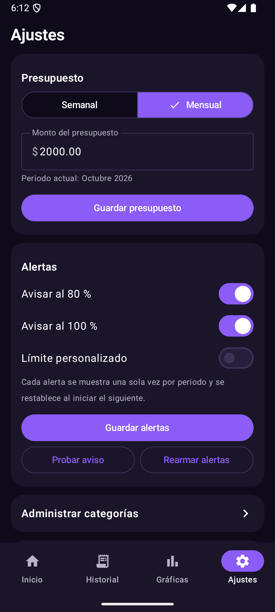 | 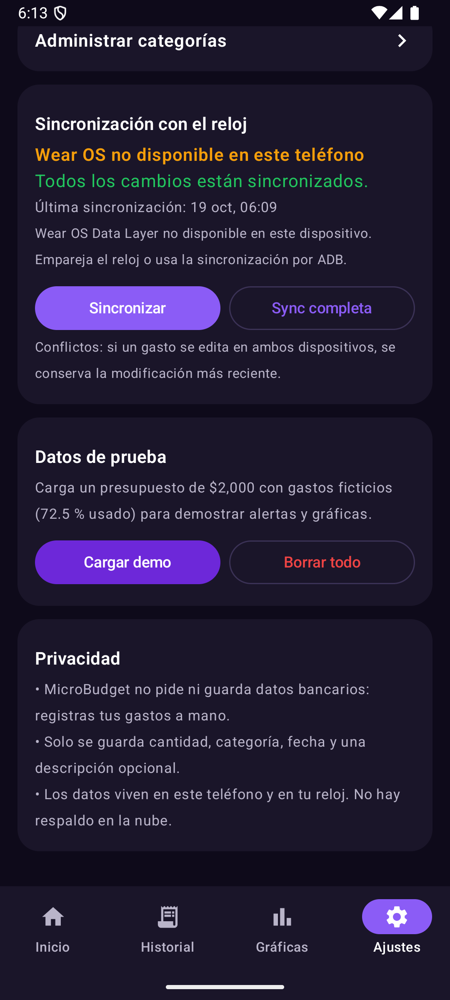 | 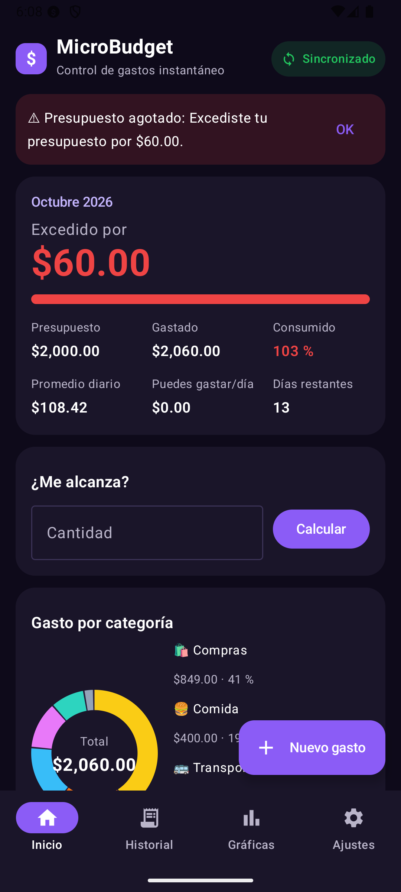 |

- **Inicio**: indicador de sincronización (verde/naranja/gris), resumen del periodo, aviso de alerta, «¿Me alcanza?», dona por categoría y 5 gastos recientes.
- **Historial**: filtros por fecha (Todo, Hoy, Este periodo, 7 días, 30 días, Rango personalizado con calendario) y por una o varias categorías; agrupado por día con subtotal. Tocar un gasto abre la edición.
- **Gráficas**: dona y barras por categoría con %, número de gastos; barras por día del periodo (hoy en morado).
- **Formulario**: cantidad con teclado decimal, chips de categoría, selector de fecha y hora, descripción; botón de eliminar con confirmación cuando se edita.
- **Ajustes**: presupuesto semanal/mensual, alertas (80 %, 100 %, límite personalizado), categorías, sincronización, datos de prueba y privacidad.
- **Categorías**: lista con editar/eliminar y diálogo con nombre, 18 emojis y 10 colores.
