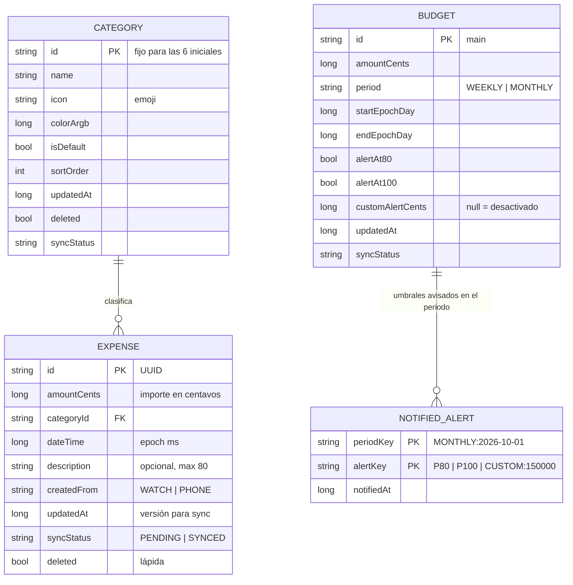

# 4. Modelo de datos

## 4.1 Diagrama entidad-relación



Archivos: entidades en `core/data/src/main/java/com/microbudget/data/local/Entities.kt`; modelo de dominio en `core/domain/src/main/kotlin/com/microbudget/domain/model/Models.kt`.

## 4.2 Decisiones

| Decisión | Motivo |
|---|---|
| `id` = UUID generado en el dispositivo | Permite crear gastos sin conexión en ambos lados sin colisiones. |
| Importes: `BigDecimal` (escala 2) en lógica, `Long` centavos en BD, texto `"45.10"` en JSON | Exactitud: `0.10 + 0.20 = 0.30`, no `0.30000000000000004`. |
| Categorías iniciales con id fijo (`food`, `transport`, …) y `updatedAt = 0` | Ambos dispositivos las crean idénticas; no generan conflictos. |
| Borrado lógico (`deleted`) | El borrado debe sincronizarse; un borrado físico "desaparecería" sin avisar al otro dispositivo. |
| `syncStatus` por registro | Permite mostrar al usuario exactamente cuántos cambios faltan por sincronizar. |
| `startDate`/`endDate` en el presupuesto | Se recalculan automáticamente al cambiar de periodo (no cambian `updatedAt`). |
| Tabla `notified_alerts` | Recuerda qué umbrales ya se avisaron en el periodo actual. |

## 4.3 Reglas de actualización

**Totales y estadísticas nunca se guardan**: se recalculan desde la tabla de gastos cada vez que cambia (Room `Flow`). Por eso crear, editar o eliminar siempre deja los números correctos.

| Operación | Regla |
|---|---|
| Crear gasto | Validar importe y categoría → insertar `PENDING` → evaluar alertas → intentar sincronizar. |
| Editar gasto | Validar → `updatedAt = max(ahora, anterior + 1)` → `PENDING` → reevaluar alertas (puede rearmar un umbral si el total baja). |
| Eliminar gasto | `deleted = true`, `PENDING` → deja de contar en totales y gráficas → se sincroniza el borrado. |
| Eliminar categoría | Lápida en la categoría; sus gastos pasan a «Otros» (`PENDING`). «Otros» no se puede eliminar. |
| Cambiar presupuesto/periodo | Recalcular `startDate`/`endDate`, `PENDING`, reevaluar alertas. |
| Nuevo periodo | `periodKey` cambia → se borran los umbrales avisados de periodos anteriores. |
| Recibir del otro dispositivo | Resolver con Last-Writer-Wins; lo aceptado queda `SYNCED`; reevaluar alertas. |

## 4.4 Cálculos

```
presupuesto_inicial = budget.amount
gastado            = Σ gastos no eliminados con fecha dentro del periodo
disponible         = presupuesto_inicial − gastado          (negativo ⇒ se muestra "Excedido por |disponible|")
% consumido        = round(gastado × 100 / presupuesto_inicial)
promedio_diario    = gastado / días transcurridos (incluye hoy)
puedes_gastar/día  = disponible / días restantes (incluye hoy), 0 si no queda
estado             = OK (< 80 %) · WARNING (≥ 80 %) · EXCEEDED (gastado > presupuesto)
¿Me alcanza?(x)    = YES si (gastado + x) < 80 % · TIGHT si 80–100 % · NO si > 100 %
```
